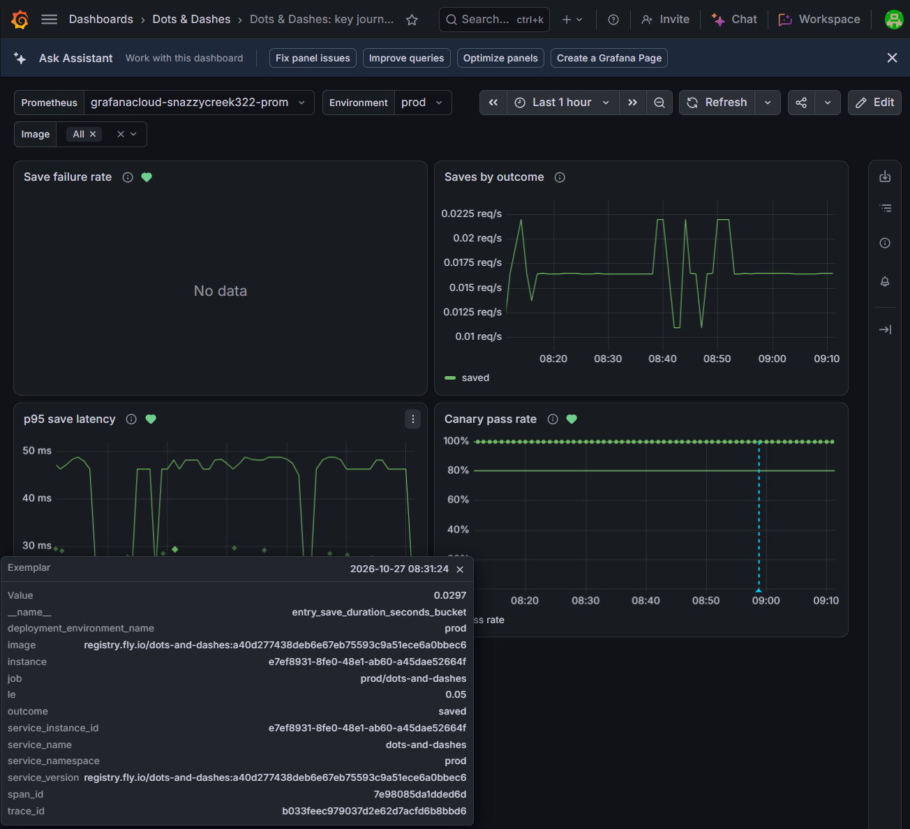
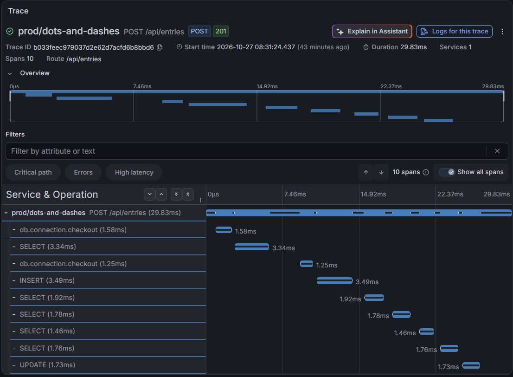
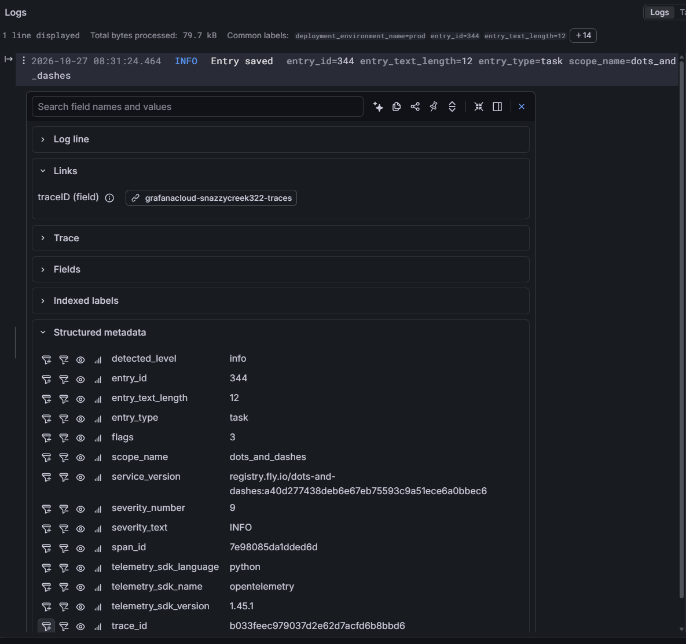
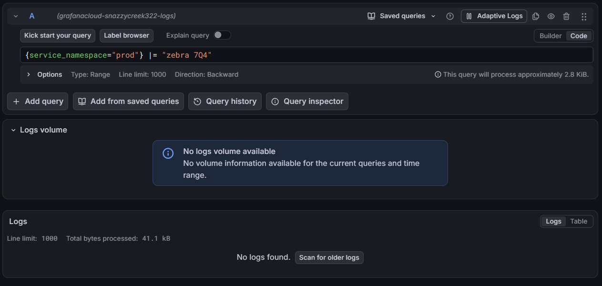
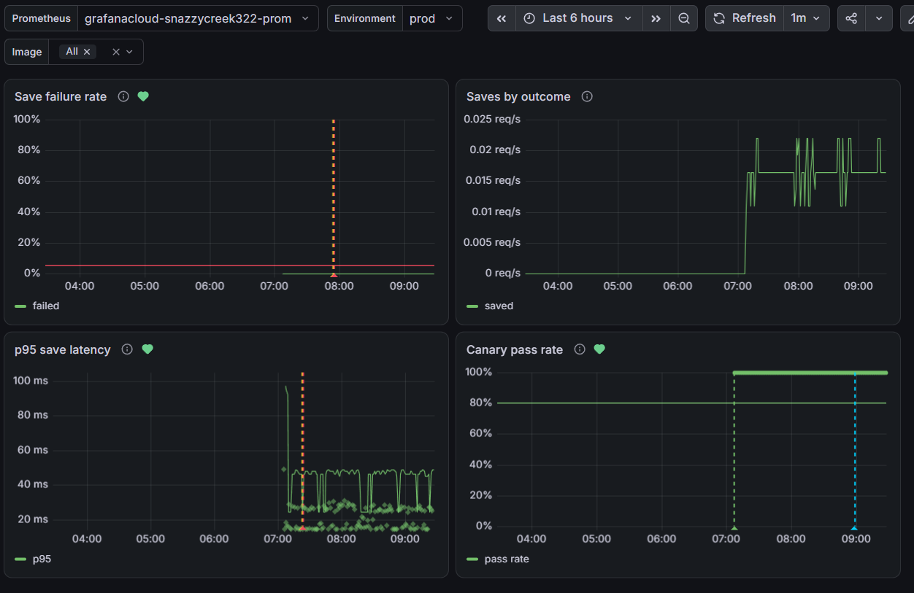
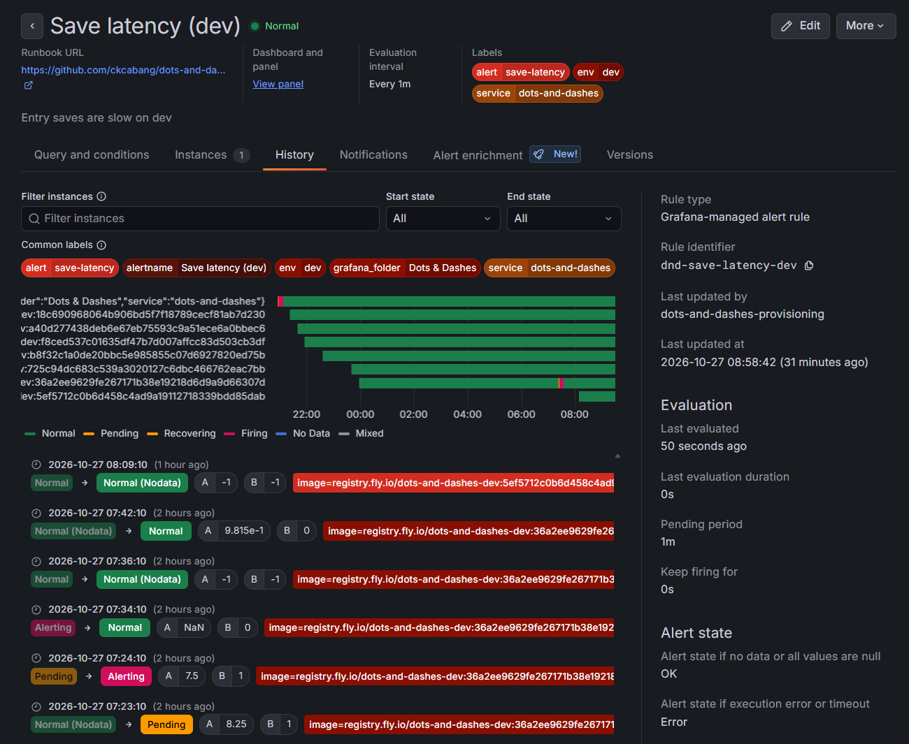

# Evidence screenshots

Course reviewers can't log in to Grafana Cloud, and Grafana keeps data for 14 days, so these screenshots are the record of what it showed. The criterion → evidence table is in the [README](../../README.md#course-criteria-and-evidence). Each image is a PNG in this folder, under the name shown.

## Observability

One Entry save on prod, followed through all three signals by one trace ID.

1. **The metric's exemplar.** The **p95 save latency** panel on the **Dots & Dashes: key journey** dashboard, with an exemplar's tooltip open showing its `trace_id`.

   

2. **The trace.** The same trace ID in Tempo: the `POST /entries` span, its `db.connection.checkout` and statement spans, and the attributes `entry.type`, `entry.text_length` and `entry.id`, with no Entry text.

   

3. **The log line.** The `Entry saved` log in Loki on the same trace ID, with its structured fields.

   

4. **No Entry text in the logs.** A Loki search for the exact text of an Entry just logged on prod, over the app's logs, finding nothing.

   

## Alerting

5. **The dashboard**, `env` = `prod`: save failure rate, saves by outcome, p95 save latency and canary pass rate.

   

6. **Each alert rule** ([`monitoring/alert-rules.json`](../../monitoring/alert-rules.json)), in Grafana's **Alerting → Alert rules**, folder **Dots & Dashes**:

   | Rule | Screenshot |
   |---|---|
   | Save failures (prod) |  |
   | Save latency (prod) |  |
   | Canary failing (prod) |  |
   | Save failures (dev) |  |
   | Save latency (dev) |  |
   | Canary failing (dev) |  |

7. **An alert firing**: a rule in the Firing state, with its query over the threshold.

   

The On-call agent's incident issues record each staged incident in text, with the alert's values, trace IDs, log queries and the remedy's output: [#91](https://github.com/ckcabang/dots-and-dashes/issues/91), [#93](https://github.com/ckcabang/dots-and-dashes/issues/93), [#94](https://github.com/ckcabang/dots-and-dashes/issues/94).
