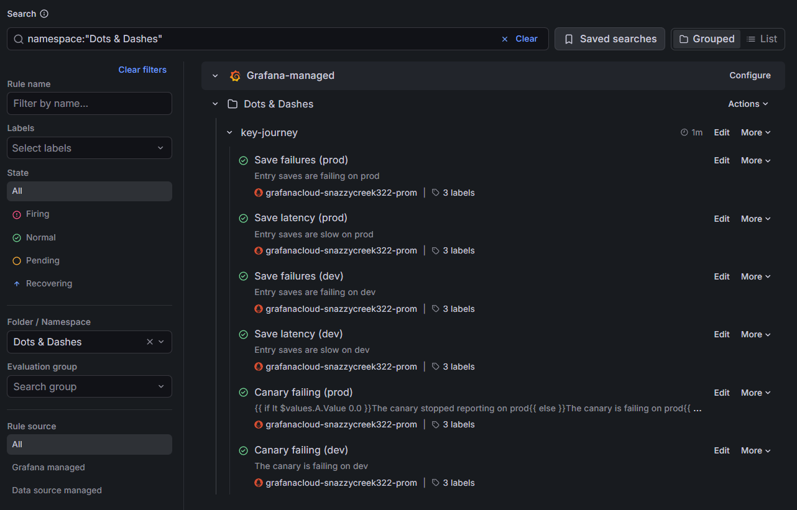

# Evidence screenshots

Course reviewers can't log in to Grafana Cloud, and Grafana keeps data for 14 days, so these screenshots are the record of what it showed. They were taken on 2026-10-27; Grafana shows times in US Pacific (PT, UTC−7). The criterion → evidence table is in the [README](../../README.md#course-criteria-and-evidence).

## Observability

One Entry save on prod, a canary save at 08:31:24 PT on image `a40d277`, followed through all three signals by its trace ID, **`b033feec979037d2e62d7acfd6b8bbd6`**.

1. **The metric's exemplar.** On the **Dots & Dashes: key journey** dashboard (`env` = `prod`), an exemplar of `entry_save_duration_seconds_bucket` on the **p95 save latency** panel. Its tooltip shows `trace_id` `b033feec979037d2e62d7acfd6b8bbd6` and `span_id` `7e98085da1dded6d`. The tooltip offers no link to the trace, so the trace was opened from Explore → Tempo.

   

2. **The trace.** Trace `b033feec979037d2e62d7acfd6b8bbd6` in Tempo: the save's root span, `POST /api/entries` (the canary's route; a save from the Daily Log is `POST /entries`), answered 201 in 29.83 ms, with its `db.connection.checkout` spans and one span per SQL statement. The statements' values are not recorded, only the statements with placeholders.

   

3. **The log line.** The `Entry saved` log in Loki at 08:31:24.464 PT, with `trace_id` `b033feec979037d2e62d7acfd6b8bbd6` and `span_id` `7e98085da1dded6d`, the same as the exemplar's. Its fields are `entry_id`, `entry_type` and `entry_text_length`: no Entry text.

   

4. **No Entry text in the logs.** A Task with the text `evidence zebra 7Q4` was logged on prod at 09:18 PT and deleted afterwards. A Loki search of prod's logs for `zebra 7Q4` finds no lines.

   

## Alerting

5. **The dashboard**, `env` = `prod`, over the last 6 hours: save failure rate (0%, under the 5% threshold line), saves by outcome, p95 save latency with its exemplars, and canary pass rate.

   

6. **The alert rules** ([`monitoring/alert-rules.json`](../../monitoring/alert-rules.json)): Grafana's **Alerting → Alert rules** list, folder **Dots & Dashes**, group `key-journey`, evaluated every minute. It shows all six rules: Save failures, Save latency and Canary failing, each for prod and dev.

   

7. **An alert firing.** The state history of **Save latency (dev)** during the pool-exhaustion scenario ([#93](https://github.com/ckcabang/dots-and-dashes/issues/93)):
   - Normal (NoData) → Pending at 07:23:10 PT;
   - Pending → Alerting at 07:24:10 PT (14:24Z), with p95 7.5 s;
   - Alerting → Normal at 07:34:10 PT, after the On-call agent raised the pool size.

   

The On-call agent's incident issues record each staged incident in text, with the alert's values, trace IDs, log queries and the remedy's output: [#91](https://github.com/ckcabang/dots-and-dashes/issues/91), [#93](https://github.com/ckcabang/dots-and-dashes/issues/93), [#94](https://github.com/ckcabang/dots-and-dashes/issues/94).
